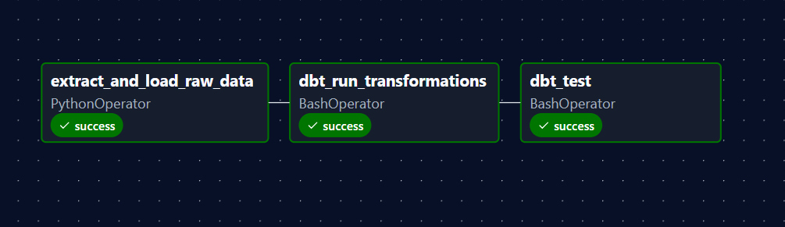
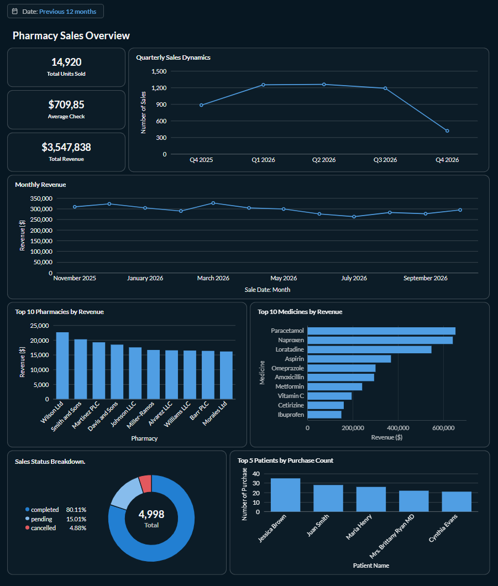
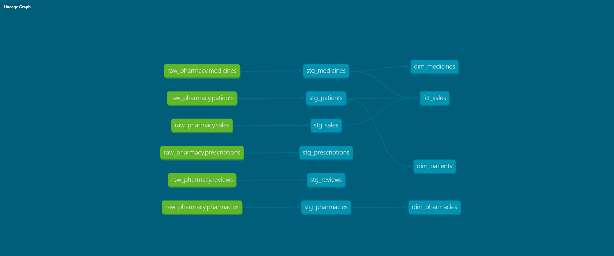

# Pharmacy Data Warehouse

An end-to-end **ELT analytics pipeline** for a pharmacy chain: synthetic transactional data is generated with Python, stored in a Parquet data lake, loaded into a PostgreSQL data warehouse, modelled with **dbt** into a star schema, orchestrated daily with **Airflow** and explored in a **Metabase** BI dashboard.

The project answers typical business questions of a pharmacy chain: how revenue develops over time, which pharmacies and medicines bring the most money, who the most active patients are and how many sales are completed, pending or cancelled.

## What this project demonstrates

- **Data engineering:** ELT design, data lake (Parquet), raw / staging / marts layers, star schema, idempotent loads
- **Data quality:** intentionally dirty source data cleaned in dbt, automated tests, documentation and data lineage generated from code
- **Orchestration:** a daily Airflow DAG (load, transform, test)
- **BI and analytics:** KPI cards, trends, rankings and a status breakdown in a dashboard with a date filter, built on SQL joins over the star schema
- **Engineering practice:** Docker Compose, environment variables, Conventional Commits, documented setup

> The data is **synthetic** (generated with Faker), so the numbers illustrate the analysis and do not describe a real company.

## Architecture

```
Airflow DAG: pharmacy_elt_pipeline (@daily)

extract_and_load_raw_data  -->  dbt_run_transformations  -->  dbt_test
  (PythonOperator)               (BashOperator)                (BashOperator)

Python (Faker + Pandas) -> Parquet (data_lake/) -> PostgreSQL (raw)
  -> dbt (staging -> marts, schema: analytics) -> dbt tests
  -> Metabase dashboard
```



## Tech stack

- Python 3.12 (Airflow does not support 3.14 yet)
- Pandas, Faker, PyArrow
- SQLAlchemy, psycopg2
- python-dotenv
- dbt-core, dbt-postgres
- Apache Airflow 3
- Docker / Docker Compose, PostgreSQL 16
- Metabase (BI dashboards)

> Airflow does not run natively on Windows. On Windows use **WSL2** (Ubuntu) for the Airflow part and keep the project inside the Linux file system (for example `~/pharmacy-data-warehouse`), not under `/mnt/c` or OneDrive.

## Results

### BI dashboard (Metabase)

Interactive dashboard **Pharmacy Sales Overview** built on top of the `analytics` schema (`fct_sales` joined with `dim_patients`, `dim_medicines`, `dim_pharmacies`):



| Chart | Type | Description |
|---|---|---|
| Total Units Sold / Average Check / Total Revenue | KPI | key business metrics |
| Quarterly Sales Dynamics | Line | number of sales per quarter |
| Monthly Revenue | Line | sum of `total_amount` per month |
| Top 10 Pharmacies by Revenue | Bar | join with `dim_pharmacies` |
| Top 10 Medicines by Revenue | Row | join with `dim_medicines` |
| Top 5 Patients by Purchase Count | Bar | join with `dim_patients` |
| Sales Status Breakdown | Donut | completed / pending / cancelled |

A dashboard-level **Date filter** is connected to all cards.

**Key insights**

- About 80% of sales are `completed`, 15% `pending` and 4.9% `cancelled`.
- Total revenue is about $3.5M with an average check of about $710.
- Paracetamol, Naproxen and Loratadine generate the highest revenue.
- The drop in the last month or quarter is an artifact: the current period is incomplete.

### Data lineage (dbt docs)



The graph shows the full path: `raw_pharmacy` sources -> `stg_*` staging models -> `dim_*` and `fct_sales` marts.
`stg_prescriptions` and `stg_reviews` are not used in marts yet (see the roadmap).

To generate and open the documentation:

```bash
dbt docs generate --project-dir pharmacy_dbt --profiles-dir pharmacy_dbt
dbt docs serve    --project-dir pharmacy_dbt --profiles-dir pharmacy_dbt --port 8081
```

## Data model (raw layer)

**Dimensions**

| Table | Description | Rows |
|---|---|---|
| `patients` | Patients (name, birth date, city) | 500 |
| `medicines` | Medicines (name, price, active flag) | 100 |
| `pharmacies` | Pharmacies / locations (name, address, city, registration date) | 525* |

**Facts**

| Table | Description | Rows |
|---|---|---|
| `sales` | Sales of medicines (patient, medicine, pharmacy, quantity, status) | 5000 |
| `prescriptions` | Issued prescriptions (patient, medicine, doctor, dosage) | 1500 |
| `reviews` | Patient reviews of medicines (rating 1-5, comment) | 1000 |

Fact tables reference the dimensions through foreign keys: `patient_id`, `medicine_id`, `pharmacy_id`.

\* 500 unique pharmacies + 25 intentional duplicates.

### Intentionally "dirty" data

The raw layer keeps data exactly as it comes from the source, so the following issues are generated on purpose and handled in the dbt staging layer:

- about 10% of pharmacies have a `NULL` address
- about 5% of pharmacies are duplicated rows
- about 20% of prescriptions have a `NULL` doctor name
- about 20% of reviews have a `NULL` comment

## dbt project

The dbt project lives in `pharmacy_dbt/` and reads from the `raw` schema, writing to the `analytics` schema.

```
pharmacy_dbt/
├── dbt_project.yml
├── profiles.yml
└── models/
    ├── staging/              # cleaning layer (views)
    │   ├── src_pharmacy.yml  # raw sources
    │   ├── schema.yml        # data quality tests
    │   ├── stg_patients.sql
    │   ├── stg_medicines.sql
    │   ├── stg_pharmacies.sql
    │   ├── stg_sales.sql
    │   ├── stg_prescriptions.sql
    │   └── stg_reviews.sql
    └── marts/                # star schema (tables)
        ├── schema.yml        # model descriptions and tests
        ├── dim_patients.sql
        ├── dim_medicines.sql
        ├── dim_pharmacies.sql
        └── fct_sales.sql
```

### Staging layer

| Model | What it does |
|---|---|
| `stg_patients` | selects patient columns |
| `stg_medicines` | splits the strength out of the name into a `dosage` column, clamps negative prices to 0, casts price to `numeric(10,2)` |
| `stg_pharmacies` | removes duplicates (keeps the earliest `registration_date` per `pharmacy_id`), replaces empty addresses with `Unknown`, renames `address` to `pharmacy_address` |
| `stg_sales` | selects sale columns, renames `status` to `sale_status` |
| `stg_prescriptions` | replaces empty doctor names with `Unknown`, renames `dosage` to `intake_instructions` |
| `stg_reviews` | replaces empty comments with `No comments`, renames `comment` to `user_comment` |

### Marts layer (star schema)

| Model | Type | Description |
|---|---|---|
| `dim_patients` | dimension | patients |
| `dim_medicines` | dimension | medicines with cleaned price and separate `dosage` column |
| `dim_pharmacies` | dimension | deduplicated pharmacies |
| `fct_sales` | fact | sales joined with patients and medicines, with `total_amount = quantity * price` |

### Data quality tests

Tests are defined in `models/staging/schema.yml` and `models/marts/schema.yml` and run by `dbt test` (the last task of the DAG):

| Model | Column | Tests |
|---|---|---|
| `stg_patients` | `patient_id` | `unique`, `not_null` |
| `fct_sales` | `sale_id` | `unique`, `not_null` |

## Airflow pipeline

The DAG `pharmacy_elt_pipeline` is defined in `airflow/dags/pharmacy_pipeline.py` and runs daily.

| Task | Operator | Description |
|---|---|---|
| `extract_and_load_raw_data` | PythonOperator | generates data, saves Parquet files and loads them into the `raw` schema |
| `dbt_run_transformations` | BashOperator | `dbt run`: builds staging views and marts tables |
| `dbt_test` | BashOperator | `dbt test`: data quality gate |

Dependencies: `extract_and_load_raw_data >> dbt_run_transformations >> dbt_test`.

The task `extract_and_load_raw_data` uses `TRUNCATE` + append instead of `DROP`, so the dbt views that depend on the `raw` tables are not broken on re-runs. Retries: 1 attempt after 5 minutes.

## Project structure

```
pharmacy-data-warehouse/
├── airflow/
│   └── dags/
│       ├── pharmacy_pipeline.py      # the DAG
│       └── scripts/
│           └── data_generator.py     # generate data + load to PostgreSQL (used by the DAG)
├── pharmacy_dbt/                     # dbt project (staging + marts + tests)
├── docs/
│   └── airflow_graph.png             # screenshot of the successful DAG run
├── images/
│   ├── dashboard.png                 # Metabase dashboard screenshot
│   └── lineage.png                   # dbt data lineage screenshot
├── data_generator.py                 # standalone generator
├── load_to_dwh.py                    # standalone loader
├── docker-compose.yml                # PostgreSQL + Metabase services
├── .dist.env                         # template for environment variables
├── requirements.txt
├── .gitignore
├── LICENSE
└── README.md
```

## Getting started

### Prerequisites

- Git
- Docker Desktop (running)
- Python 3.12 (on Windows: WSL2 with Ubuntu for Airflow)

### 1. Clone the repository

```bash
git clone https://github.com/IrynaKilyk/Pharmacy-Data-Warehouse.git
cd Pharmacy-Data-Warehouse
```

### 2. Create a virtual environment and install dependencies

```bash
python3.12 -m venv venv
source venv/bin/activate
pip install -r requirements.txt
```

### 3. Configure environment variables

```bash
cp .dist.env .env
```

Open `.env` and set your own values:

| Variable | Description |
|---|---|
| `POSTGRES_USER` | Database user |
| `POSTGRES_PASSWORD` | Database password (replace the placeholder) |
| `POSTGRES_DB` | Database name (`pharmacy_dwh`) |
| `POSTGRES_HOST` | Database host (`localhost`) |
| `POSTGRES_PORT` | Port on your machine mapped to PostgreSQL |

The `.env` file is ignored by git and must never be committed.

### 4. Start PostgreSQL and Metabase

```bash
docker compose up -d
docker ps
```

Both containers should have the status `Up`. Metabase is available at http://localhost:3000.

When adding the database in Metabase, use host `dwh_postgres` (the Docker Compose service name, not `localhost`), port `5432`, database `pharmacy_dwh` and the credentials from your `.env`. Charts use the `analytics` schema.

### 5. Run the pipeline manually

```bash
python airflow/dags/scripts/data_generator.py     # generate Parquet files and load them into raw

set -a; source .env; set +a
dbt debug --project-dir pharmacy_dbt --profiles-dir pharmacy_dbt
dbt run   --project-dir pharmacy_dbt --profiles-dir pharmacy_dbt
dbt test  --project-dir pharmacy_dbt --profiles-dir pharmacy_dbt
```

### 6. Run the pipeline with Airflow

In every new terminal activate the environment first:

```bash
cd ~/pharmacy-data-warehouse
source venv/bin/activate
set -a; source .env; set +a
export AIRFLOW_HOME=$PWD/airflow
```

Check that the DAG has no import errors and start Airflow:

```bash
airflow dags list-import-errors     # expected: No data found
airflow standalone
```

Then:

1. Open http://localhost:8080 and sign in as `admin`. The password is printed in the terminal or stored in `airflow/simple_auth_manager_passwords.json.generated`.
2. Find `pharmacy_elt_pipeline`, enable it and press **Trigger**.
3. Open the DAG graph and wait until all three tasks are green.

If a task fails, open it and check **Logs**. If you fix the cause, use **Clear Task** to re-run it.

## Verifying the result

```bash
docker exec -it pharmacy-data-warehouse-dwh_postgres-1 psql -U <POSTGRES_USER> -d pharmacy_dwh -c "SELECT COUNT(*) FROM raw.sales;"
```

| Check | Expected |
|---|---|
| `raw.sales` rows | 5000 |
| `raw.pharmacies` rows | 525 |
| `analytics.dim_pharmacies` rows | 500 (duplicates removed) |
| `analytics.fct_sales` rows | 5000 |
| `dbt test` | all tests pass |

To stop the containers:

```bash
docker compose down        # keeps the data volume
docker compose down -v     # also deletes the data volume
```

## Git workflow

- `develop`: the working branch, all changes are committed here as separate, focused commits
- `main`: stable version, updated by merging `develop` through a pull request

Commit messages follow the Conventional Commits style (`feat:`, `fix:`, `docs:`, `chore:`, `refactor:`, `test:`).

## Roadmap

- [x] Data lake and ingestion (extract and load)
- [x] Transformations with dbt (staging and star schema)
- [x] Orchestration with Apache Airflow and data quality tests
- [x] BI dashboard with Metabase, dbt docs and data lineage
- [ ] More dbt tests: `relationships` between `fct_sales` and the dimensions, `accepted_values` for `sale_status`
- [ ] Marts for prescriptions and reviews (`fct_prescriptions`, `fct_reviews`) so that all staging models are used
- [ ] A folder with analytical SQL queries (CTEs, window functions)

## License

This project is licensed under the MIT License. See the [LICENSE](LICENSE) file for details.
